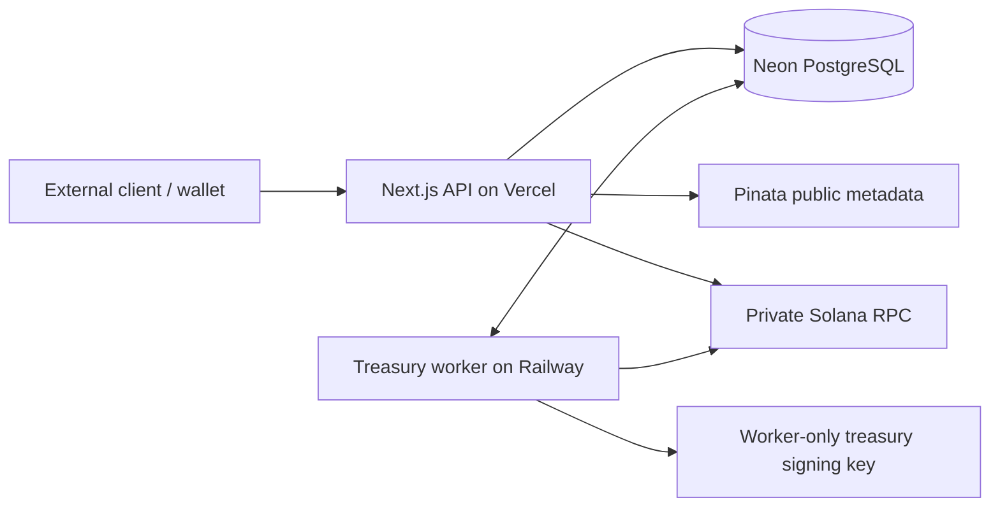
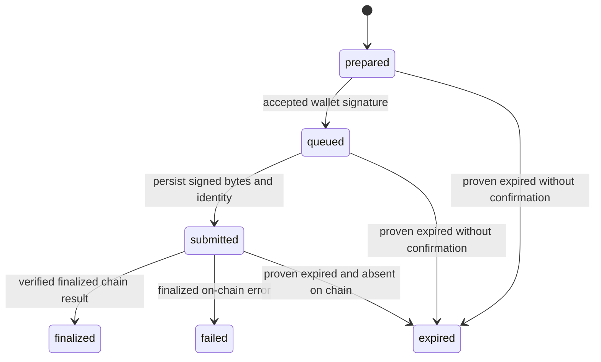

# Finder Keepers

**The backend behind Artemi: launch a Solana coin, fund its treasury, and distribute location-based token rewards.**

Finder Keepers contains Artemi's API, treasury worker, database migrations, geographic distribution engine, and backend tests. It does **not** contain the website, map renderer, wallet connection UI, CSS, animations, or brand assets.

| Product rule | Current behavior |
| --- | --- |
| Network | Solana mainnet; pump.fun Token-2022 launches |
| Minimum creator purchase | **0.2 SOL principal** |
| Reward funding | Tokens attributable to the **first 0.2 SOL** of curve principal |
| Creator allocation | Purchased tokens remaining after the reward allocation |
| Bag size | **300,000 tokens** for new launches |
| Distribution | Random land locations across Europe and the USA; equal regional counts, with a random side receiving an odd extra bag |
| Eligibility | Within **10,000 metres**, including the boundary |
| Lifetime | Bags appear after finalized funding and remain until claimed or retired by an operator withdrawal |
| Claim limit | First successful claimant per bag; no per-wallet collection limit |
| Costs | Creator pays launch costs; claimant pays claim fees and associated token-account rent; no Artemi platform fee |

Protocol fees, network fees, and account rent are **additional** to the 0.2 SOL principal. A larger creator purchase does not increase reward funding or bag count. Whole bags are created with integer arithmetic; a smaller remainder stays in the treasury. At the initial curve verified for the source release, 0.2 SOL funds 7,105,960.264900 tokens: 23 bags and a 205,960.264900-token remainder. The API computes fresh quotes from on-chain state rather than promising that example forever.

## Contents

- [Architecture](#architecture)
- [Quick start](#quick-start)
- [Configuration](#configuration)
- [API reference](docs/API.md)
- [Transaction lifecycle](#transaction-lifecycle)
- [Geography and location](#geography-and-location)
- [Database and migrations](#database-and-migrations)
- [Testing](#testing)
- [Deployment](#deployment)
- [Treasury operations and recovery](docs/OPERATIONS.md)
- [Security model and limits](#security-model-and-limits)

## Architecture



The API authenticates wallets, validates requests, prepares transactions, and records submissions. The worker signs treasury transfers, persists transaction identity before broadcasting, and reconciles finalized chain results. PostgreSQL coordinates reservations and retries. One custodial treasury wallet owns separate associated token accounts for each mint.

The API remains Next.js because that is the existing server runtime. React packages are framework dependencies; this repository contains no application UI. No custom on-chain custody program is deployed by this code.

```text
app/api/          HTTP route handlers only
lib/              Authentication, validation, Solana builders, accounting, geography
lib/data/         Versioned land polygons and source attribution
worker/           Persistent transaction consumer and emergency withdrawals
migrations/       Ordered artemi_ PostgreSQL migrations
scripts/          Migration, simulation, diagnostics, and operator commands
tests/            Backend tests, including isolated in-memory PostgreSQL tests
docs/             API contract and operations runbook
Dockerfile        Railway worker image
```

## Quick start

Requirements: **Node.js 24**, npm, an existing PostgreSQL/Neon database for this application, Solana HTTP/WebSocket RPC access, and Pinata credentials for metadata uploads. A funded creator wallet is needed only for an actual launch; an RPC credential does not authorize spending.

```sh
git clone https://github.com/artemi-tech/finder-keepers.git
cd finder-keepers
npm ci
```

Copy `.env.example` to `.env` and `.env.worker.example` to `.env.worker`. Fill the API and worker configuration separately. Keep the same database, RPC network, and treasury public key across both processes.

For a **new, empty treasury only**, create a local key:

```sh
node scripts/init-treasury.mjs
```

The command refuses to overwrite a key and prints only its public address. Set that address in both environment files. Local worker startup can read `.secrets/treasury.json`; production uses the worker's secret environment variable. For an existing treasury, recover the existing key instead of generating a replacement. See [recovery](docs/OPERATIONS.md#treasury-key-recovery).

Apply migrations, then start the two processes in separate terminals:

```sh
npm run db:migrate
npm run dev
```

```sh
npm run worker:local
```

The API runs at `http://localhost:3000/api`. The worker's health server defaults to port `8080`. `/` is not a website and normally returns 404. `GET /api/health` reports database and worker readiness; a healthy API response alone does not mean the worker is ready.

**Environment loading:** Next.js loads `.env` for the API. `db:migrate` explicitly loads `.env`; `worker:local` explicitly loads `.env.worker`. Plain `npm run worker` expects runtime variables to already be present, as on Railway. Do not load a worker secret key into the API process.

**Browser integration:** mutations require an `Origin` equal to the API request's origin, and sessions use SameSite=Strict cookies. Arbitrary cross-origin browser calls are intentionally unsupported. A separate frontend must integrate with a same-origin API arrangement; when using a gateway, verify that the request origin visible to the backend matches the browser's origin. This repository does not contain frontend proxy configuration or permissive CORS.

## Configuration

| Variable | API | Worker | Purpose |
| --- | --- | --- | --- |
| `NEON` | Required | Required | Existing PostgreSQL connection string; `DATABASE_URL` is a supported fallback |
| `SOLANA_HTTPS_ENDPOINT` | Required | Required | Private HTTP RPC on the same Solana network |
| `SOLANA_WSS_ENDPOINT` | Required | Required | Private WebSocket RPC |
| `ARTEMI_TREASURY_PUBLIC_KEY` | Required | Required | Public address matching the worker key |
| `PINATA_JWT` | Required for uploads | No | Public image and metadata uploads |
| `PINATA_GATEWAY` | Required for images | No | Gateway hostname or HTTPS origin |
| `ARTEMI_ADMIN_PASSWORD_HASH` | Optional operator API | No | `hexSalt:hexScryptHash`; see the runbook |
| `ARTEMI_TREASURY_PRIVATE_KEY` | **Never** | Required in production | JSON array of 64 secret-key bytes |
| `ARTEMI_TREASURY_KEY_FILE` | No | Local launcher only | Optional local key file, default `.secrets/treasury.json` |
| `PORT` | Supplied by host/start command | Optional | Worker health port, default 8080 |

`VERCEL` is supplied by Vercel and enables trust in its location headers. Do not set it on an untrusted public server that accepts caller-controlled forwarding headers. GitHub, Vercel, and Railway management tokens are provisioning credentials, **not runtime variables**. No credentials, treasury keys, deployment credentials, or production database exports are included in this repository.

## Transaction lifecycle

### Launch

1. Authenticate with a signed nonce, then upload token metadata.
2. Request a current quote and prepare a transaction. Inputs include name, ticker, image, optional X/website links, and developer purchase in SOL.
3. The API builds and simulates an atomic mint creation, token purchase, treasury account creation, and reward transfer. Creator identity and normal pump.fun creator-fee entitlement are preserved; optional special modes are disabled.
4. Wallets using the v0 path may first need a lookup-table setup transaction. After setup finalizes, prepare again. The v1 path supports a single launch approval when the wallet supports that format.
5. Submit the wallet-signed transaction. The backend checks signatures and message integrity; it restores the server mint co-signature when necessary.
6. The worker broadcasts and waits for **finalized** confirmation. It checks the exact message, mint program/decimals, treasury deposit, and creator allocation before registering the coin and publishing bags.

Bag denomination is snapshotted in each new launch attempt. Historical coins retain their recorded denomination. Locations and bags are inserted in the registration transaction; retries cannot reshuffle an already registered coin.

### Claim

1. Supply a bag ID and fresh browser coordinates, or use available server-derived IP coordinates.
2. The API checks eligibility and locks the bag row. A database constraint prevents a second active/successful claim for the same bag.
3. The claimant signs a fixed transfer transaction and pays network costs and token-account creation if needed.
4. The worker adds the treasury signature, persists signed bytes and transaction identity, and broadcasts.
5. Finalization verifies recipient and treasury balance changes before marking the bag claimed.



An HTTP timeout is not transaction failure. Reconnect and poll the existing attempt ID. A confirmed signature is not released merely because its blockhash is old. The worker reconciles before retrying or releasing a reservation. Emergency withdrawals enter the queue through an operator flow rather than claimant signing.

## Geography and location

New bag locations are cryptographically sampled from versioned Natural Earth land polygons. Bounding regions are weighted by spherical area, latitude is sampled in sine space, and points outside land or inside polygon holes are rejected. This distributes rewards beyond cities, including rural locations. Region counts are split evenly between Europe and the USA.

Coverage includes the contiguous USA, Alaska and Hawaii, European country land inside the documented envelope, Cyprus and eastern Thrace. Coastlines, small islands, the eastern Europe cutoff and Turkish straits use generalized boundaries. This is not parcel-access or navigability data. Full source, checksum and coverage details: [lib/data/README.md](lib/data/README.md).

Browser evidence must be no more than two minutes old (with a small clock-skew allowance). Without it, Vercel IP coordinates may qualify a claim. Missing evidence allows browsing but prevents claiming. Great-circle distance is calculated server-side. Only eligibility/source evidence is retained in claim payloads; precise user coordinates are not stored as a location history.

## Database and migrations

All application tables use the **`artemi_`** prefix. Reuse the application's existing database and treasury when continuing an existing deployment. Do not create a new database or run a database-wide reset as an upgrade step.

| Group | Tables |
| --- | --- |
| Identity | `artemi_nonces`, `artemi_sessions`, `artemi_admin_sessions`, `artemi_rates` |
| Rewards | `artemi_coins`, `artemi_locations`, `artemi_bags`, `artemi_uploads` |
| Transactions | `artemi_attempts`, `artemi_lookups`, `artemi_worker_health` |
| Operations | `artemi_controls`, `artemi_withdrawals`, `artemi_withdrawal_items`, `artemi_migrations` |

Migrations are ordered and recorded by filename. Apply them before deploying code that requires new columns. They preserve original 100k/500k bag records while changing the default for new coins to 300k. Reversibly archived coins disappear from user-facing queries, while audit records and on-chain history remain intact. Historical curated locations are retained for audit but no longer seeded or selected for new bags.

## Testing

These checks require no provider secrets and do not broadcast transactions:

```sh
npm test
npm run typecheck
npm run lint
npm run build
```

The backend suite covers purchase boundaries, integer allocation, bag sizes and remainders, historical denominations, regional splits, geographic coverage, 10 km eligibility, signature/message tampering, Phantom guard validation, transaction codecs, replay/expiry decisions, upload retry deduplication, emergency controls, scoped refunds, and archives. PostgreSQL-dependent unit tests use disposable in-memory PGlite databases.

Additional checks are explicit operations:

| Command | External effects |
| --- | --- |
| `npm run test:api -- https://YOUR_API_HOST` | Creates temporary authentication/rate-limit records and reads live quotes; no spending or transaction broadcast |
| `node --env-file=.env --import tsx scripts/probe-single-launch.ts 0.2` | Read-only mainnet simulation; no broadcast |
| `node --env-file=.env --import tsx scripts/test-database.ts` | Creates/drops an isolated `artemi_test_<uuid>` schema in the configured database |
| `node --env-file=.env --import tsx scripts/test-catalog.ts` | Same isolated-schema approach for catalog tests |

Only run integration commands against a database/provider you administer. Unit tests do not require a real wallet signature. Successful simulation is not evidence of a new finalized launch or claim; a real end-to-end check requires a funded wallet and its signature.

## Deployment

**API — Vercel:** import this private repository as a Next.js project, Node 24, install `npm ci`, build `npm run build`. Configure only the API variables listed above. Use the Vercel-generated URL. This is an API-only deployment; a missing homepage is expected.

**Worker — Railway:** deploy the root `Dockerfile`, configure only worker variables, and use the existing plan/entitlements. The image starts `npm run worker`. Configure HTTP health checks against `/` on Railway's supplied `PORT`; readiness requires a recent successful worker heartbeat. The worker handles graceful termination and bounded retry backoff; database locking and persisted transaction identities protect against duplicate work.

Upgrade order: back up application data and treasury recovery material; apply migrations; deploy and verify the worker; deploy the API; verify health and authenticated quote/submission behavior. Record provider IDs and deployment URLs in private operational records. Never copy a full provisioning `.env` into a runtime deployment.

This repository is an extraction of Artemi's backend, not a migration of its current live services. Publishing this source does not reconfigure the existing website, database, or worker. Production-specific provider IDs and credentials have intentionally not been copied into it.

## Security model and limits

- Custody is trusted: the Artemi operator controls the treasury key and can withdraw reserved tokens. Creator self-withdrawal is not exposed.
- IP and browser location can be spoofed. This version accepts that limitation; it does not prove physical presence.
- Sessions use signed one-use nonces, hashed session tokens, HttpOnly/SameSite=Strict cookies, production Secure cookies, and origin validation for mutations. Sessions last 24 hours; operator sessions last four hours.
- Mutations are validated and rate-limited. Token amounts and lamports cross API boundaries as decimal strings; never convert them to floating point for accounting.
- Launch messages are checked strictly. Setup/claim transactions permit only the explicitly validated readonly Phantom Lighthouse guards; transfers, fees, payer, blockhash, or privileges cannot be silently changed.
- Images are restricted to bounded PNG/JPEG/WebP uploads; the image endpoint resolves stored CIDs through the configured gateway rather than accepting arbitrary fetch URLs.
- Server errors/logs avoid credentials and signed payload dumps. Signature-free mismatch diagnostics are private operational data.
- Dependencies are pinned with a lockfile. The upstream SDK and its transitive dependencies have known audit advisories; run `npm audit` during upgrades and review compatible fixes. Do not use `npm audit fix --force` without checking transaction behavior and compatibility. This code has not undergone an independent security audit.

## Sources and maintenance

The extraction is based on Artemi source commit `8088a47`, with frontend code removed and standalone configuration/documentation added. Core transaction and accounting logic is preserved.

- [Community pump SDK](https://github.com/nirholas/pump-fun-sdk), pinned `@nirholas/pump-sdk` 3.0.0
- [Official pump.fun protocol documentation](https://github.com/pump-fun/pump-public-docs)
- [Solana documentation](https://solana.com/docs)
- [Pinata API documentation](https://docs.pinata.cloud/api-reference/endpoint/upload-a-file)
- [Vercel location headers](https://vercel.com/docs/headers/request-headers)
- [Natural Earth data terms](https://www.naturalearthdata.com/about/)

Maintained by **artemi-tech**. Contact: **kaylielabadie089@gmail.com**. This is a private project; no open-source license is granted by this repository. Third-party packages and geographic data retain their own licenses.
