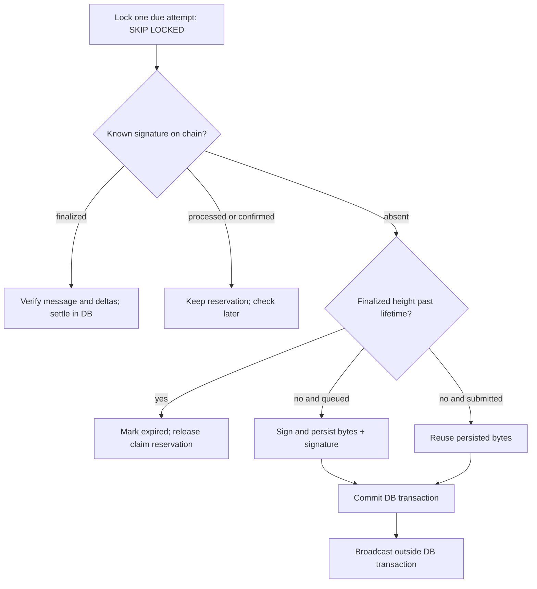

# Reading and extending the backend

[Back to README](../README.md) · [Replication](REPLICATION.md) · [Database](DATABASE.md)

## Read in this order

1. [lib/domain.ts](../lib/domain.ts): pure integer accounting, denominations, distance and regional counts.
2. [lib/chain.ts](../lib/chain.ts): RPC configuration, quotes and Solana instruction builders.
3. [lib/attempts.ts](../lib/attempts.ts): request validation, preparation, reservations and signed submissions.
4. [lib/wire.ts](../lib/wire.ts) and [lib/wallet-guards.ts](../lib/wallet-guards.ts): transaction codecs, signatures and narrowly allowed wallet additions.
5. [worker/index.ts](../worker/index.ts): persisted transaction processing, broadcast and finalization.
6. [worker/emergency.ts](../worker/emergency.ts): operator withdrawals using the same attempt/reconciliation pipeline.

## Module responsibilities

| Files | Responsibility and boundary |
| --- | --- |
| [API dispatcher](../app/api/%5B...path%5D/route.ts) | Routes public/authenticated HTTP operations; dispatches to library functions |
| [Operator dispatcher](../app/api/admin/%5B...path%5D/route.ts) | Separate operator session and withdrawal controls |
| `lib/auth.ts`, `admin.ts`, `admin-password.ts` | Wallet nonce/session flow, operator sessions and scrypt password verification |
| `lib/http.ts`, `validation.ts` | Request limits, origin checks, error responses and metadata validation |
| `lib/db.ts` | PostgreSQL pool and commit/rollback wrapper; no client-side database access |
| `lib/control.ts` | Shared pause state checked inside preparation/submission transactions |
| `lib/pinata.ts` | Authenticated upload, metadata construction and retry deduplication |
| `lib/catalog.ts`, `activity.ts` | Read models for coins, bags and finalized events; archive filtering |
| `lib/coin-image.ts` | Stored-CID image retrieval with type/size constraints |
| `lib/value.ts` | Cached indicative bonding-curve bag value; null when unavailable |
| `lib/geography.ts`, `lib/data/land.json` | Versioned polygon sampling using cryptographic randomness |
| `lib/coin-refund.ts` | Scoped creator refund, verification and archive rules |
| `lib/reconciliation.ts` | Pure decision function for finalize/wait/expire/retry |

## Launch: request to finalized reward inventory

`prepareLaunch()` checks worker readiness, throttling and the market pause inside a database transaction. It resolves metadata owned by the authenticated wallet and reuses active attempts. The v0 path checks for a usable lookup table; if absent, it prepares a setup attempt first. The v1 path uses the codec in `wire.ts` instead.

`launchInstructions()` fetches initial reserves/fee configuration, generates the mint and constructs creation, purchase, treasury ATA creation and transfer instructions in one transaction. The mint signs on the server; the creator signs as fee payer and buyer. No mint secret is needed after its prepared co-signature is stored. `simulateWire()` runs before the attempt is returned; simulation is not a broadcast or proof of finality.

`submit()` authenticates ownership of the attempt, checks the wallet signature and expected message, restores unchanged mint co-signatures when needed, and queues the bytes. Launch messages must remain identical. Setup/claim messages may contain only the readonly wallet guards accepted by `hasOnlyWalletGuards()`; that is not permission to change payer, transfers or compute costs.

The worker verifies the finalized message, Token-2022 mint decimals and exact treasury/creator token deltas. Only then does it insert the coin, locations and bags in one database transaction. `ON CONFLICT(mint) DO NOTHING RETURNING mint` gates placement: an already registered launch is never placed a second time. A rolled-back registration has not published locations yet.

## Claim: reservation is not settlement

`prepareClaim()` validates fresh browser evidence or trusted server IP evidence before reserving a bag. `FOR UPDATE OF b` serializes conflicting reservations; the partial unique claim index is an additional guard. It builds the transfer with the persisted bag amount and simulates it. Only a successful preparation commits the reservation and attempt together.

The payload stores `locationSource` and `eligible`, not the claimant's precise coordinates. A caller moving a map or sending a mint alone cannot reserve a bag. The actual trust limits are broader: browser positions and IP locations can be spoofed.

`buildClaim()` sets the claimant as fee payer and ATA payer, while the treasury is token transfer authority. The worker adds the second signature only after the API has accepted the claimant's message. See [the signing walkthrough](TREASURY.md#who-pays-a-claim-fee).

## Retry boundary: commit before network submission

`submitted` means the identity was persisted; a crash can occur before RPC submission. Retrying those same bytes produces the same transaction identity. Do not rebuild with a new blockhash while the old transaction's outcome is unresolved.

`reconciliationAction()` keeps any known non-finalized signature reserved even after blockhash expiry. Expiry requires no signature status and a finalized height beyond `last_valid_height`. RPC exceptions schedule retries; they are not evidence that a transfer failed. Finalized failures release claims, but may still incur network fees.

The worker selects due rows with `FOR UPDATE SKIP LOCKED`, uses a savepoint around processing, and backs errors off exponentially up to 60 seconds. A loop processes up to ten due attempts, runs emergency work, records a heartbeat, then waits two seconds. API readiness requires a successful heartbeat within 90 seconds. SIGINT/SIGTERM finish current work and mark the worker stopped; force-killed processes rely on heartbeat expiry and persisted attempts.

## Changes that require coordinated work

| Change | Read/change together | Verification |
| --- | --- | --- |
| Reward principal or denomination | `domain.ts`, preparation payload, migration defaults, historical fallback in worker | `domain.test.ts`, `refund.test.ts`, `test-catalog.ts`; preserve old bag amounts |
| Launch instructions or SDK | `chain.ts`, `wire.ts`, pinned lockfile | Wire/transaction tests, size/compute simulation, then authorized finalized launch |
| Wallet message policy | `wallet-guards.ts`, `wire.ts`, submission | Guard/tamper tests; do not bypass signature checks |
| Retry state or reservation behavior | `reconciliation.ts`, worker, database indexes | Reconciliation/retry tests and isolated DB concurrency check |
| Geographic coverage | `geography.ts`, data generator and data README | Geography tests; version/checksum the generated catalog |
| Operator controls | `control.ts`, `coin-refund.ts`, emergency worker | Emergency/refund tests; never use real withdrawal as a smoke test |

Tests demonstrate the conditions they assert, not a complete security audit or provider availability. [Replication](REPLICATION.md) separates offline checks, integration checks and real wallet-authorized transfers.
