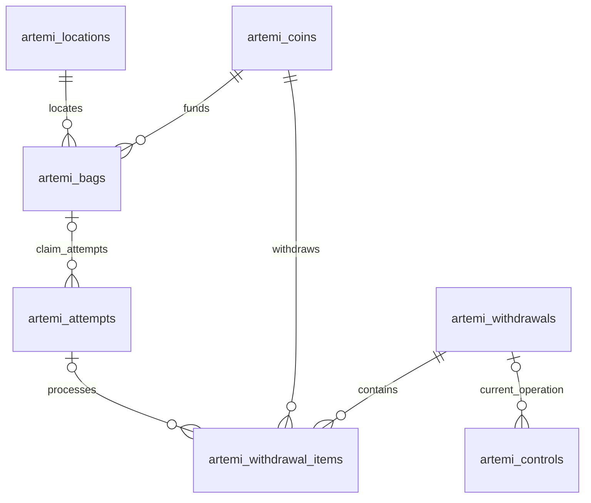

# Database model and migrations

[Back to README](../README.md) · [Code guide](CODE_GUIDE.md)

All owned objects use `artemi_`. Money is stored as integer `numeric(30,0)` or decimal strings; never use floating-point conversions to settle transfers. PostgreSQL returns numeric values as strings, which the code converts to `bigint` for arithmetic.



## Records and meaning

| Table | Important fields / meaning |
| --- | --- |
| `artemi_nonces` | One-use wallet challenge message and expiry |
| `artemi_sessions` | Hashed token, wallet, expiry; raw cookie is not the database key |
| `artemi_admin_sessions` | Hashed operator token, password tag and expiry |
| `artemi_rates` | Throttle key, count and reset time |
| `artemi_uploads` | Wallet-owned public metadata and image/URI references |
| `artemi_coins` | Mint primary key, original reward allocation, decimals, launch signature, denomination, withdrawal/archive accounting |
| `artemi_locations` | Persisted public reward coordinates, region, source and distribution version; not claimant locations |
| `artemi_bags` | Coin/location foreign keys, fixed base-unit amount, state, claimant and settlement signature |
| `artemi_attempts` | Kind, wallet, optional bag, state, prepared message/bytes, signed bytes, signature, lifetime, payload, retry schedule |
| `artemi_lookups` | Per-wallet finalized lookup address |
| `artemi_worker_health` | Singleton worker readiness heartbeat |
| `artemi_controls` | Singleton pause state and current withdrawal batch |
| `artemi_withdrawals` | Destination, waiting/running/completed batch state |
| `artemi_withdrawal_items` | Per-batch/per-mint transfer progress and attempt reference |
| `artemi_migrations` | Applied migration filenames and timestamps |

Attempt payloads depend on kind. Launches snapshot metadata, reward/total/principal, decimals, treasury and bag denomination. Claims record amount, decimals and location eligibility/source. Wallet mismatch diagnostics can contain unsigned message bytes. The database contains usable signed transaction bytes after submission: treat backups and database access as sensitive even though private keys are absent.

## Constraints that matter

- `artemi_one_active_claim`: one attempt per bag in `prepared`, `queued`, `submitted` or `finalized`. Failed/expired attempts permit a future retry; finalized attempts continue to exclude competitors.
- `artemi_one_pending_launch_per_wallet`: one pending attempt for each `(wallet, kind)` where kind is launch/setup. It is not a global one-launch limit.
- Unique transaction signatures and coin launch signatures prevent duplicate recorded identities.
- `artemi_single_withdrawal`: only one waiting/running withdrawal batch at a time.
- Bag row locking and attempt locking pair with these constraints. Constraints do not replace chain reconciliation.

Bag states are `available → reserved → claimed`, with failed/expired claims returning a reserved bag to available. Operator withdrawals retire unclaimed bags as `withdrawn`. Attempts use `prepared`, `queued`, `submitted`, `finalized`, `failed`, `expired`; see the [code guide](CODE_GUIDE.md#retry-boundary-commit-before-network-submission).

## Migration order

| File | Adds or changes |
| --- | --- |
| [001_initial.sql](../migrations/001_initial.sql) | Identity, rewards, attempts, readiness and initial constraints |
| [002_lookup.sql](../migrations/002_lookup.sql) | Setup attempts and finalized lookup addresses |
| [003_launch_idempotency.sql](../migrations/003_launch_idempotency.sql) | Pending launch/setup uniqueness |
| [004_emergency.sql](../migrations/004_emergency.sql) | Operator sessions, withdrawal queue, pause and retired bags |
| [005_bag_size_archive.sql](../migrations/005_bag_size_archive.sql) | Archives and per-coin denomination; old rows retain 100k, new default becomes 500k |
| [006_300k_bags.sql](../migrations/006_300k_bags.sql) | New coin default becomes 300k without rewriting historical rows |

`npm run db:migrate` loads `.env` and executes unapplied SQL files in filename order. Each file and its migration record commit together. Run one migration process at a time: the runner does not hold a global migration lock. Individual SQL files are not all independently rerunnable; use the runner's ledger rather than manually replaying files.

For a new independent installation, use its own database configuration. For an existing deployment, reuse its current database and apply only new migrations. Do not rewrite an applied migration, drop the shared schema, or substitute an empty database while retaining a funded treasury. There are no automated down migrations; back up first and prefer forward fixes.

## Safe read-only reconciliation queries

Run these only with operator access. They read application data and do not change states:

```sql
SELECT kind, status, count(*)
FROM artemi_attempts
GROUP BY kind, status ORDER BY kind, status;

SELECT id, kind, status, signature, next_retry_at, tries
FROM artemi_attempts
WHERE status IN ('prepared', 'queued', 'submitted')
ORDER BY next_retry_at;

SELECT mint, bag_tokens, treasury_amount, withdrawn_amount, rewards_withdrawn
FROM artemi_coins WHERE archived_at IS NULL;
```

Do not export `signed_base64`, sessions, or complete payloads to public issue reports. An accounting query cannot prove settlement; inspect the finalized transaction message and token deltas as the worker does.
